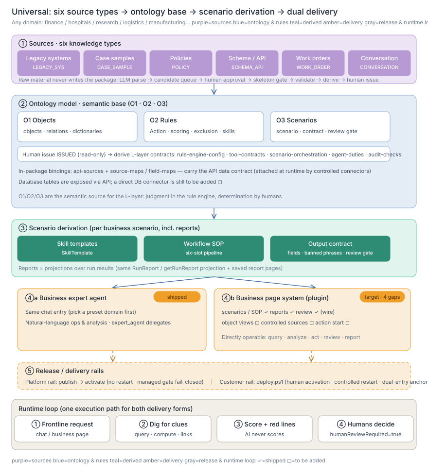

# dsh-onto

[English](README.md) | [中文](README.zh.md)

**Business ontology modeling + AI-assisted decision platform** built on [DeepSeek Harness](https://github.com/deepseek-ai/deepseek-harness) (`dsh`).

Turn expert business criteria into machine-validatable, issuable, derivable structures —
O1 objects / O2 behavior rules / O3 scenario cards. One line to remember:

> **Judgment lives in the rule engine; determination lives with humans.**

## Overview

Universal pipeline: **Knowledge → Ontology → Platform assembly → Decision support**.
Any domain swaps package content only — the skeleton stays the same.



> Chinese original: [README.zh.md](README.zh.md) · [docs/overview-pipeline.zh.svg](docs/overview-pipeline.zh.svg)

## From one sentence to a self-running loop

**⓪ Choose before chat.** The new-session hero chip pre-selects an expert preset (AML / TAX /
MED) and the session header keeps the active expert in view. A started session's composition
cannot be hot-switched — use `expert_agent` to delegate to an expert child agent, or open a
new session.

**① Build.** One sentence creates the model: `create_package` (with `humanApproved`) →
skeleton proposal → `save_skeleton` → sliced drafting (`draft_elements`; drafts enter the
queue, never the package) → human review on the canvas → materialization through the **I6
skeleton gate** → validate → derive → load gate → human issue (0 errors + ≥ 1 scenario card +
≥ 1 score rule; review/issue transitions re-derive in the same transaction).

**② Apply.** An issued package is a read-only application — `run_scenario` / `invoke_expert`,
the Web Scenarios tab, or the CLI. Every run yields candidates, risk scores, hit rule IDs,
evidence chains and pending checks with `humanReviewRequired=true`: machines screen clues and
assemble evidence; humans decide.

**③ Operate.** Each run turns the loop: run records (audit + forbidden-phrase scan) →
experience signatures → recall hints (never re-scores) → human annotation → SkillTemplate
drafts → approved methodology upgrades. ISSUED is read-only — evolution forks a new version;
a knowledge side-path (conversation turns, uploaded docs) feeds the model through the
human-approved queue.

## Why

Business judgment criteria usually scatter across code, configs, and individual experts'
heads: every AI capability re-aligns the same semantics, thresholds drift between releases,
and compliance boundaries get bolted on after the fact. dsh-onto makes the criteria the
product: they are modeled as versioned YAML packages, validated by a rule engine, issued
through human review, and derived into fingerprinted runtime contracts — while the LLM is
kept on a short leash (drafting only, never scoring, never issuing verdicts).

## Features

- **Packages** — create / import / export / version fork / human issue (`DRAFT → IN_REVIEW →
  ISSUED`; ISSUED is read-only) · `dsh-onto package *` · Web
- **Conversational modeling** — one sentence → skeleton → sliced drafts → human review →
  materialize behind the I6 skeleton gate · main chat · Web
- **Knowledge pipeline** — 6 source types → LLM parsing → candidate queue → human approval ·
  `dsh-onto knowledge *` · Web
- **Validator & deriver** — reference closure, weights, `derived/**` fingerprints, load gate
  (`DERIVED_DRIFT`) · `dsh-onto validate` / `derive` / `gate`
- **Rule engine** — exclusions then weighted scoring; every score points back to a rule ID · core
- **Scenario runs** — pipeline dispatch, three-layer audit, run history A/B compare, audit
  export · `dsh-onto run` / `runs *` · Web
- **Trusted business execution** — three-state data status, six-tuple authorization,
  decision→proposal ledger, external receipts + reconciliation (no receipt ⇒ `unknown`),
  ticket-sim & test adapters · lives in **`@dsh-onto/runtime`** · `record_review_decision` /
  `create_action_proposal` / `execute_behavior_action` / `reconcile_action`
- **Experience loop** — run records → recall hints → human annotation → SkillTemplate
  upgrades · `dsh-onto exp *` · Web
- **Expert presets** — AML / TAX / MED picked before chat; `expert_agent` dispatches expert
  sub-agents · hero chip · main chat
- **Multi-domain** — AML + MED + TAX ship as package content only, zero engine changes ·
  `packages/`

## Repository layout

Dependency direction: **`core` ← `runtime` ← `backend` (assembly)** · workbench talks to
backend over remote services only.

```
dsh-onto/
  core/       @dsh-onto/core — pure engine library + CLI (zero harness deps; 236 node --test acceptance tests)
  runtime/    @dsh-onto/runtime — shared run & governance library: data connectors,
              identity/authorization, run records, review/approval, action ledger,
              reconciliation (no auto dsh assembly; backend and future business
              plugins depend on it — never the reverse)
  backend/    @dsh-onto/backend — dsh bundle: development wires (model/knowledge/issue)
              + assembly shell over @dsh-onto/runtime (onto* landing point; 289 tests)
  workbench/  @dsh-onto/workbench — dsh bundle: Web UI (six tabs + persistent right-rail ontology graph)
  mock-services/ ticket-sim — standalone ticket simulation service (self-persisting SQLite,
              idempotent across processes, fault injection, reconciliation; receipts always `simulated`)
  packages/   example business ontology packages (first-class deliverables): aml/1.0.0, med/1.0.0, tax/1.0.0
  examples/   scenario run fixtures (aml-run.json / med-run.json / tax-run.json)
  scripts/    setup-profile.ps1 / dev-web.ps1 / dump-config.ps1
              ensure-expert-presets.ps1 (+ expert-presets.json, preset-plugins.standard.yaml: idempotent expert-preset block)
  docs/       architecture.md — self-contained concepts & rules (Chinese)
              overview-pipeline.{zh,en}.svg — end-to-end pipeline diagrams
```

## Requirements

- Node.js ≥ 24.9 and pnpm 11.x
- A [deepseek-harness](https://github.com/deepseek-ai/deepseek-harness) checkout as a sibling
  directory (`../deepseek-harness`), already run through `pnpm install && pnpm run build`.
  The harness is a **read-only** dependency — dsh-onto never modifies it.

## Quick start

```powershell
# 1. Create the `dsh-onto` profile, install both bundles, seed the example packages
dsh-onto\scripts\setup-profile.ps1
# 2. Assert the composed profile still contains @dsh-onto/backend + @dsh-onto/workbench
#    (runtime ships as a library dependency of backend, not a separate bundle)
dsh-onto\scripts\dump-config.ps1
# 3. Launch the Web UI (open the printed dsh web URL) → sidebar entry "dsh-onto"
dsh-onto\scripts\dev-web.ps1
```

The workbench exposes six tabs: **Packages · Modeling · Knowledge · Validate & Derive ·
Scenarios · Experience** (plus a persistent **Ontology graph** in the right rail).

## CLI (no browser needed)

```powershell
cd dsh-onto\core
pnpm install; pnpm run build

node dist\cli.js package create --name demo --version 1.0.0 --domain DEMO --root ..\workspace
node dist\cli.js package issue --name demo --version 1.0.0 --by <human> --root ..\workspace
node dist\cli.js validate ..\packages\aml\1.0.0
node dist\cli.js derive   ..\packages\aml\1.0.0
node dist\cli.js gate     ..\packages\aml\1.0.0
node dist\cli.js run      ..\packages\aml\1.0.0 SCN-AML-FIND-CLUES --data ..\examples\aml-run.json --out result.json
node dist\cli.js runs compare <runA> <runB> --root ..\workspace
node dist\cli.js knowledge upload --package demo --type LEGACY_SYS --name algo --file algo.txt --root ..\workspace
node dist\cli.js knowledge parse --source <id> --llm deepseek --root ..\workspace
node dist\cli.js exp recall --dir ..\packages\aml\1.0.0 --scenario SCN-AML-FIND-CLUES --data ..\examples\aml-run.json
```

## License

[MIT](LICENSE)
