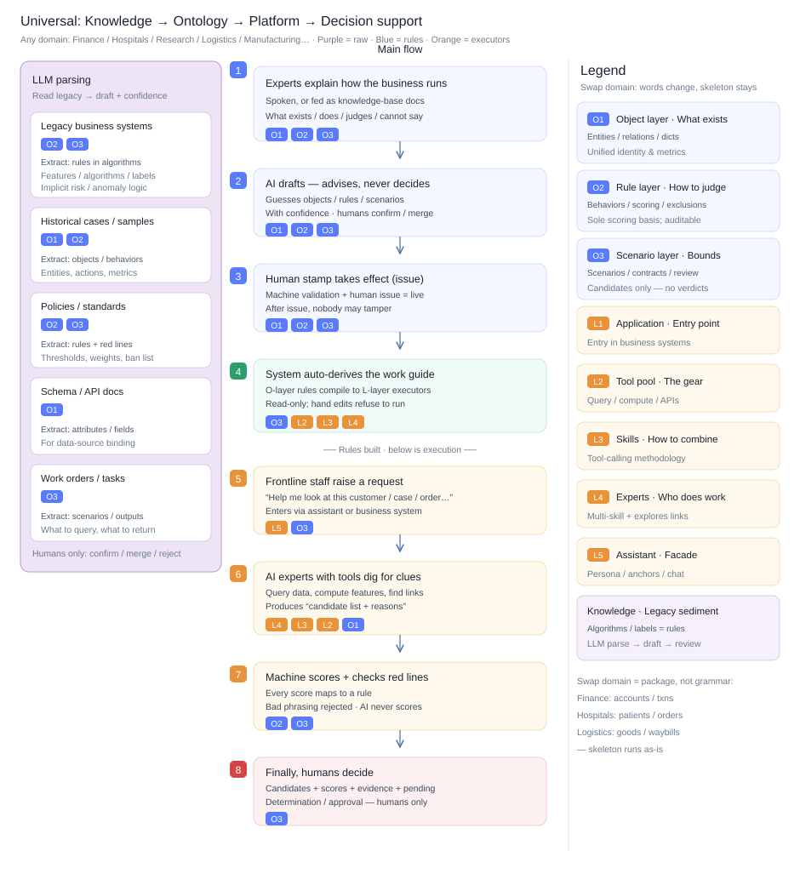

# dsh-onto

[English](README.md) | [中文](README.zh.md)

**Business ontology modeling + AI-assisted decision platform** built on [DeepSeek Harness](https://github.com/deepseek-ai/deepseek-harness) (`dsh`).

Turn expert business criteria into machine-validatable, issuable, derivable structures —
O1 objects / O2 behavior rules / O3 scenario cards. One line to remember:

> **Judgment lives in the rule engine; determination lives with humans.**

## Overview

Universal pipeline: **Knowledge → Ontology → Platform assembly → Decision support**.
Any domain swaps package content only — the skeleton stays the same.



> Chinese original: [README.zh.md](README.zh.md) · [docs/overview-pipeline.zh.svg](docs/overview-pipeline.zh.svg)

## From one sentence to a self-running loop

**① Build phase — one sentence creates the model.** The user states intent in the main chat
("I want to spot credit-card cash-out; create an ontology package for that"). The agent
de-duplicates and calls `create_package` (requires `humanApproved` — only when the user
explicitly asked), then proposes a **skeleton** (full ID list + scale budget + trade-offs).
After the user confirms, `save_skeleton` lands it; O1→O2→O3 slices are drafted with
`draft_elements` — drafts only enter the queue, never the package — and dashed nodes grow
on the canvas (workbench panel + the persistent ontology graph beside the chat). Humans
approve via the in-node ✓/✕ or the inspector (single or bulk); materialization passes the
**I6 skeleton gate** (out-of-skeleton IDs are refused with the reason surfaced). Finally
validate → derive → load gate → submit review → **human issue**: the issue gate requires
0 validation errors, at least 1 scenario card + 1 score rule, and a green derive + load
gate; issue/review transitions re-derive in the same transaction, so the package is
loadable the moment it is issued.

**② Application phase — running real business on the model (this is the "use").** An issued
package is a read-only, reusable *application*: the agent runs `run_scenario` /
`invoke_expert` from one sentence, the Web Scenarios tab executes on pasted data, the CLI
runs `dsh-onto run` directly. Every run yields candidates, risk scores, hit rule IDs,
evidence chains and pending checks with `humanReviewRequired=true` — machines screen
clues and assemble evidence; humans decide in the review queue.

**③ The operating loop during application use.** Each business use turns the loop once:
run records (three-layer audit + forbidden-phrase scan + data fingerprint) → experience
signature (`ruleShape` semantic fingerprint: same ID with changed weight/expression is a
different shape, so stale diff tables are never reused) → next run of the same scenario
auto-recalls prior guidance via `recall_experience` (hints only, never re-scores) → the
human annotates the outcome / mis-transfer judgment (judged-by required) / review focus
(structural-token whitelist; free text never enters the methodology) → homogeneous
experience clusters become SkillTemplate drafts via `abstract_experience`
(`humanApproved` to enqueue) → human approval materializes them — one methodology
upgrade complete. **Write-back boundary**: ISSUED is read-only, so evolution forks a new
version back into the build phase (`abstract_experience` skips ISSUED packages); a
knowledge side-path keeps feeding the model — conversation turns auto-ingest as
CONVERSATION material, uploaded legacy/policy/API docs are LLM-parsed into candidates
that humans approve into the package.

## Why

Business judgment criteria usually scatter across code, configs, and individual experts'
heads: every AI capability re-aligns the same semantics, thresholds drift between releases,
and compliance boundaries get bolted on after the fact. dsh-onto makes the criteria the
product: they are modeled as versioned YAML packages, validated by a rule engine, issued
through human review, and derived into fingerprinted runtime contracts — while the LLM is
kept on a short leash (drafting only, never scoring, never issuing verdicts).

## Features

| Capability | Entry point |
|---|---|
| Package management: create / import / export / version fork / issue state machine (DRAFT → IN_REVIEW → ISSUED; ISSUED is read-only) + **hard issue gate** (0 errors + non-empty scenario/rules + derive/load gate) | `dsh-onto package *` · Web · Packages tab |
| **Conversational modeling**: one sentence → skeleton proposal (`humanApproved`) → sliced drafting → dashed canvas growth → node/inspector human review (single or bulk) → materialization (I6 skeleton gate) | main chat · Web · Modeling tab (panel + persistent right-rail graph) |
| Knowledge pipeline: 6 source types → LLM parsing (lexical heuristic / DeepSeek API) → candidate queue → human review (approve / reject / edit / mark-merge; red-line candidates may only merge into a scenario) | `dsh-onto knowledge *` · Web · Knowledge tab |
| Validator: reference closure / weights sum to 1.0 / dictionaries / event discipline / attribute resolution + quality score | `dsh-onto validate` · Web · Validate tab |
| Deriver: `derived/**` + manifest fingerprints + load gate (`DERIVED_DRIFT`); same-transaction re-derive after materialize / save / YAML write / status transition | `dsh-onto derive` · `dsh-onto gate` |
| Rule engine: exclusions (before-scoring) → weighted scoring (weights come from O2); every score points back to a rule ID | core engine |
| Scenario execution: minimal-step pipeline dispatch + three-layer audit closure + human-review fields + run history A/B compare + audit export | `dsh-onto run` · `dsh-onto runs *` · Web · Scenarios tab |
| **Experience loop**: run records → recall hints → human annotation (mis-transfer judged-by, structural review focus) → SkillTemplate drafts → methodology upgrades | `dsh-onto exp *` · Web · Experience tab · agent `recall_experience` · `annotate_experience` · `abstract_experience` |
| Agent tool surface: package/skeleton/draft/review, `run_scenario` · `compare_runs` · `export_audit`, `list_runs` · `list_drafts`, `invoke_expert` | main chat (grant allowlist; issue stays human-only) |
| Multi-domain by design: AML (anti-money-laundering) + MED (clinical) + TAX ship as package content only — zero engine changes | `packages/` |

## Repository layout

```
dsh-onto/
  core/       @dsh-onto/core — pure engine library + CLI (zero harness deps; 158 node --test acceptance tests)
  backend/    @dsh-onto/backend — dsh bundle: onto* wire services (single backend landing point; 167 tests)
  workbench/  @dsh-onto/workbench — dsh bundle: Web UI (six tabs + persistent right-rail ontology graph)
  packages/   example business ontology packages (first-class deliverables): aml/1.0.0, med/1.0.0, tax/1.0.0
  examples/   scenario run fixtures (aml-run.json / med-run.json / tax-run.json)
  scripts/    setup-profile.ps1 / dev-web.ps1 / dump-config.ps1
  docs/       architecture.md — self-contained concepts & rules (Chinese)
              overview-pipeline.{zh,en}.svg — end-to-end pipeline diagrams
```

## Requirements

- Node.js ≥ 24.9 and pnpm 11.x
- A [deepseek-harness](https://github.com/deepseek-ai/deepseek-harness) checkout as a sibling
  directory (`../deepseek-harness`), already run through `pnpm install && pnpm run build`.
  The harness is a **read-only** dependency — dsh-onto never modifies it.

## Quick start

```powershell
# 1. Create the `dsh-onto` profile, install both bundles, seed the example packages
dsh-onto\scripts\setup-profile.ps1
# 2. Assert the composed profile contains both @dsh-onto/* bundles
dsh-onto\scripts\dump-config.ps1
# 3. Launch the Web UI (open the printed dsh web URL) → sidebar entry "dsh-onto"
dsh-onto\scripts\dev-web.ps1
```

The workbench exposes six tabs: **Packages · Modeling · Knowledge · Validate & Derive ·
Scenarios · Experience** (plus a persistent **Ontology graph** in the right rail).

## CLI (no browser needed)

```powershell
cd dsh-onto\core
pnpm install; pnpm run build

node dist\cli.js package create --name demo --version 1.0.0 --domain DEMO --root ..\workspace
node dist\cli.js package issue --name demo --version 1.0.0 --by <human> --root ..\workspace
node dist\cli.js validate ..\packages\aml\1.0.0
node dist\cli.js derive   ..\packages\aml\1.0.0
node dist\cli.js gate     ..\packages\aml\1.0.0
node dist\cli.js run      ..\packages\aml\1.0.0 SCN-AML-FIND-CLUES --data ..\examples\aml-run.json --out result.json
node dist\cli.js runs compare <runA> <runB> --root ..\workspace
node dist\cli.js knowledge upload --package demo --type LEGACY_SYS --name algo --file algo.txt --root ..\workspace
node dist\cli.js knowledge parse --source <id> --llm deepseek --root ..\workspace
node dist\cli.js exp recall --dir ..\packages\aml\1.0.0 --scenario SCN-AML-FIND-CLUES --data ..\examples\aml-run.json
```

## Product discipline (hard rules)

1. Business judgment content lives **only** in O2/O3; the rule engine is the single scoring
   path — **LLMs never score**.
2. The LLM only drafts candidates (with confidence). Raw material **never writes into a
   package** directly; materialization happens only after human approval.
3. Verdict-style phrasing ("认定…", "guilty of…", …) may only land in a scenario's
   `forbiddenPhrases` red lines — **never** in the output contract.
4. **Determination is always human**: every run returns `humanReviewRequired = true`; the
   issue endpoint requires a human identity (`issuedBy`).
5. Derived artifacts are read-only but regenerable; hand-editing one → `DERIVED_DRIFT`
   refuses to load; re-deriving restores service.
6. Every output must include: candidate list, risk score, hit rule IDs, evidence chains,
   and pending checks — with a zero-tolerance scan for forbidden phrases.
7. **Hard issue gate**: 0 validation errors, ≥ 1 scenario card, ≥ 1 score rule, green
   derive + load gate; status transitions re-derive in the same transaction.
8. **Chat write-actions carry `humanApproved`** (create package, save skeleton, draft,
   abstract); skeleton-first, I6 on materialization, skip reasons must surface.

## Testing

- `core/tests/`: **158 tests** (`node --test tests/*.test.mjs`) — validator interceptions,
  six-source knowledge parsing, conclusion phrases kept out of O3, forced review, ISSUED
  read-only + fork, derived-drift refusal and recovery, end-to-end scenario output
  contract, rule-ID/evidence-chain/forbidden-phrase guarantees, experience signatures
  (`ruleShape` anti-false-isomorphism), issue gate (hollow/broken packages refused), and
  extra domains running on the untouched engine.
- `backend/tests/`: **167 tests** (`pnpm run test`) — agent tool contracts
  (humanApproved, skeleton-first, list_runs/list_drafts) plus source assertions
  (re-derive / gate / surfacing of skipped materializations).
- Post-change ladder: core/backend/workbench `pnpm run build` + `node --check` →
  `scripts/dump-config.ps1` → `scripts/dev-web.ps1` + browser smoke (five flows through
  the sidebar + a natural-language agent run).

## Boundaries (stated honestly)

- Knowledge parsing defaults to a deterministic lexical heuristic; the DeepSeek API path
  needs `DEEPSEEK_API_KEY` (e.g. in `~/.dsh/.env`).
- Conversational modeling is the primary entry; the canvas is a *status + review* surface
  (dashed = pending draft) — **not free-form drag-and-drop modeling** (explicitly out of scope).
- Runtime verdicts are out of scope by design: the platform screens candidates and
  assembles evidence; humans decide.

## Current progress (2026-11-09)

- Version **0.2.0**; experience-loop (PR #6) and closed-loop (PR #7, in-node review,
  bulk materialize, skill body update channel) are merged.
- A full Tabbit natural-language run through every feature (six tabs + right-rail graph +
  the agent tool surface) drove these fixes: hard issue gate (hollow/broken packages can
  no longer be issued), same-transaction re-derive on transitions (review/issue no longer
  produce `DERIVED_DRIFT`), skipped materializations surface their reasons (no more green
  checkmarks hiding I6), mis-transfer judged-by enforced in the UI before submit, canvas
  review buttons drawn in a second pass so neighboring nodes cannot swallow clicks, red-line
  candidates may only merge into a scenario carrier.
- **Expert identity layer (L4)**: `list_experts` with no args returns the global expert index (one card per package, ISSUED first, explicit no-scenario fallback, per-card focus hint); skill catalog descriptions carry a `[package@version · domain]` prefix; the modeling guide now opens with "list cards first, name it to focus" conventions.
- Verification green: core 158/158 · backend 167/167 · dump-config 2/2 · dev-web +
  browser smoke passed.

## License

[MIT](LICENSE)
