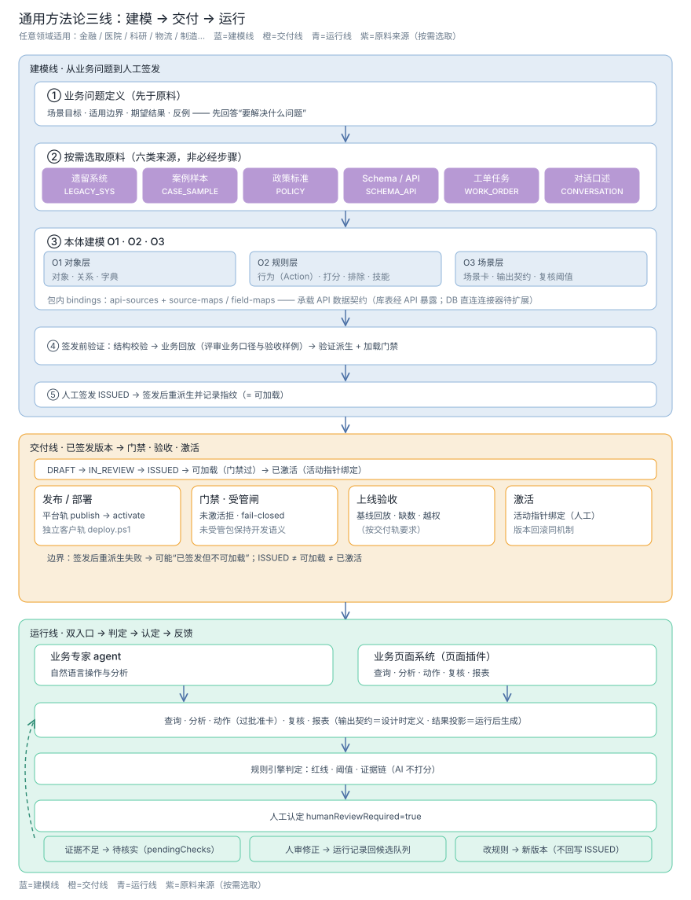

# dsh-onto — 业务本体建模平台

[English](README.md) | [中文](README.zh.md)

> 以 DeepSeek Harness（dsh）为宿主的**业务本体建模 + AI 辅助决策**平台：
> 把专家的业务口径写成机器可校验、可签发、可派生的结构；**判定在规则引擎，认定在人工**。
> 概念、规则与结构的完整定义见 [docs/architecture.md](docs/architecture.md)（自包含）。

**接入请先读：** [用户指南 — 建模 → 运行时 → 业务应用 / 智能问答](docs/user-guide.zh.md)
（English: [docs/user-guide.en.md](docs/user-guide.en.md)）

## 总览

通用链路：**六类原料 → 本体基座 → 场景派生 → 双形态交付**。任意领域只换包内容，不换骨架。



> 三条线，而不是一条流水线。**建模线**从业务问题出发（目标 · 边界 · 期望结果 · 反例），按需选取六类
> 原料，构建带包内 bindings（API 数据契约）的 O1/O2/O3 本体，签发前先验证——结构校验、业务回放、
> 验证派生 + 加载门禁——才人工签发；签发后重派生记录指纹（= 可加载）。**交付线**把已签发版本送过
> 发布/部署、受管闸、上线验收（按交付轨）与人工激活：ISSUED ≠ 可加载 ≠ 已激活。**运行线**从双入口
> （业务专家 agent / 业务页面系统）走查询 · 分析 · 动作（过批准卡）· 复核 · 报表——输出契约在设计时
> 定义、结果投影在运行后生成——进规则引擎判定与人工认定，并带回路（证据不足 → 待核实、人审修正 →
> 回候选队列、改规则 → 新版本，不回写 ISSUED）。
>
> 英文版见 [README.md](README.md) / [docs/overview-pipeline.en.svg](docs/overview-pipeline.en.svg)。

## 从一句话到自运转

**⓪ 对话前选人。** 新会话 hero 芯片预选专家 preset（反洗钱 AML / 税务 TAX / 医疗 MED），头部标签常显当前专家。**已开聊的会话组合不可热切**——要用专家就 `expert_agent` 派子 agent，或新建会话换身份。

**① 构建期。** 一句话建模：`create_package`（须 `humanApproved`）→ 骨架提案 → `save_skeleton` → 分片 `draft_elements` 起草（草案只入队、不写包）→ 画布人审 → 物化过 **I6 骨架门** → 校验 → 派生 → 加载门禁 → 人工签发（0 校验错 + ≥1 场景卡 + ≥1 打分规则；送审/签发同事务重派生）。

**② 应用期。** 签发后的包是只读应用——`run_scenario` / `invoke_expert`、Web「场景运行」或 CLI。每轮产出候选、风险分、命中规则、证据链、待核实点，恒带 `humanReviewRequired=true`：机器筛查线索与组装证据，人做认定。

**③ 经营循环。** 每轮转一圈：运行留痕 → 经验签名 → 召回提示（只提示不改分）→ 人工回填 → 技能模板草案 → 人审批准物化。ISSUED 只读，升级须 fork 新版本；知识旁路（对话轮次、上传文档）经人审批准入包。

## 能力

- **包管理** —— 建包 / 导入 / 导出 / 版本 fork / 人工签发（`DRAFT → IN_REVIEW → ISSUED`，ISSUED 只读）·
  `dsh-onto package *` · Web
- **对话式建模** —— 一句话 → 骨架 → 分片草案 → 人审 → 物化（I6 骨架门）· 主对话 · Web
- **知识管线** —— 六类原料 → LLM 解析 → 候选队列 → 人审批准 · `dsh-onto knowledge *` · Web
- **校验与派生** —— 引用闭合、权重、`derived/**` 指纹、加载门禁（`DERIVED_DRIFT`）·
  `dsh-onto validate` / `derive` / `gate`
- **规则引擎** —— 先排除后加权打分，每一分都回指规则 ID · core
- **场景运行** —— pipeline 派发、三层审计、运行历史 A/B 对比、审计导出 · `dsh-onto run` / `runs *` · Web
- **对话报表** —— 会话内交互报表（摘要卡/候选表/证据展开；筛选·展开·跳转），`show_run_report`
  与固定页共用 `getRunReport` 同一投影；用过的视图沉淀为可复用报表页，换 run 复用
  （`save_report_page`）· 主对话 · Web
- **报表组件与跨 run 对比** —— catalog `dsh-onto/report/v1` 扩至 18 组件（KeyValue/Badge/
  Callout/Progress/Timeline/Tabs + Chart bars/line/donut 多系列分组/堆叠、when 条件显隐、
  表格列类型、spark、色板）；表格导出复制 Markdown/CSV；`show_run_diff` 跨 run 对比卡
  （delta 表 + 命中/排除增删，缺席侧 null 不补 0）· 主对话 · Web
- **可信业务执行** —— 三状态数据面、六元组鉴权、决定→提案台账、外部回执与对账（无回执 ⇒ `unknown`）、
  ticket-sim 与测试适配器 · 实现在 **`@dsh-onto/runtime`** · `record_review_decision` /
  `create_action_proposal` / `execute_behavior_action` / `reconcile_action`
- **免重启声明式发布** —— `publish_business` / `activate_business` / `rollback_business`：
  已签发包按内容摘要幂等收编进发布台账，活动指针绑定新运行；已导入未激活一律拒
  **fail-closed**（受管闸）；受控数据源配置（`simulated|formal`、https 或回环 http、
  令牌只存 env 引用）随宿主启动恢复、跨进程互斥落盘 · `@dsh-onto/runtime` · 主对话
- **业务页与部署双轨** —— `plugin generate` 把已签发包生成业务运行页（缺省 **dataset 模式**：
  内联数据通道，与 Agent 同一条 `runScenario`；`--source` 走 API 映射模式，`--fixture`
  显式指定运行夹具）；`deploy.ps1` 独立客户轨：构建 → 夹具 e2e → replay → 装 profile →
  导入 → **人工激活** → 受控重启 → 双入口锚
- **经验循环** —— 运行留痕 → 召回提示 → 人工回填 → 技能模板升级 · `dsh-onto exp *` · Web
- **专家 preset** —— 对话前选 AML / TAX / MED；`expert_agent` 派专家子 agent · hero 芯片 · 主对话
- **多域零改引擎** —— AML + MED + TAX + WST + EBC 只换包内容 · `packages/`

## 目录

依赖方向：**`core` ← `runtime` ← `backend`（装配外壳）** · workbench 只经 remote 服务对接 backend ·
业务插件 `apps/*` 依赖 runtime，禁止反向依赖。

```
dsh-onto/
  core/       @dsh-onto/core — 纯引擎库 + CLI（零 harness 依赖，307 项 node --test 验收测试）
  runtime/    @dsh-onto/runtime — 公共运行与治理库：数据连接器、身份权限、运行留痕、
              复核/批准、动作台账与对账、发布台账与受控数据源（无 dsh 自动装配；backend 与业务插件
              依赖它，禁止反向依赖）
  backend/    @dsh-onto/backend — dsh bundle：开发面 wire（建模/知识/签发/发布）+
              对 @dsh-onto/runtime 的装配外壳（onto* 落点，328 项测试）
  workbench/  @dsh-onto/workbench — dsh bundle：Web UI 七 tab + 右栏常驻本体图谱
  apps/       业务插件（独立 dsh bundle）：
                aml/  @dsh-aml/app  — 治理工作台（复核队列、动作）
                tax/  @dsh-tax/app  — RUN-only 最小运行页 + Agent 同源
  mock-services/
              ticket-sim —— 独立工单模拟服务（SQLite 自身持久化、跨进程幂等、
              故障注入、对账补偿；回执恒为 simulated）
              tax-api —— 第二插件冷启动用只读税务查询 mock
              wst-api —— 自助接入验收用只读 WST 快照 API
  packages/   业务本体包示例（一等交付物）：aml/1.0.0、med/1.0.0、tax/1.0.0、
              wst/1.0.0、wst-ops/1.0.1、ebike-charging/1.0.0
  examples/   场景运行样例数据（aml-run.json / med-run.json / tax-run.json / ebc-run.json）
  scripts/    setup-profile.ps1 / dev-web.ps1 / dump-config.ps1
              setup-tax-profile.ps1 / dump-tax-config.ps1 / m-tax-seed-release.mjs
              ensure-expert-presets.ps1（+ expert-presets.json、preset-plugins.standard.yaml：专家 preset 块幂等管理）
  docs/       user-guide.{zh,en}.md —— 如何建模、挂运行时、做应用或问答
              architecture.md（自包含架构与规则）
              plugin-authoring.zh.md（第二域插件冷启动卡点表）
              ops-manual.md（正式动作门槛与对账）
              overview-pipeline.{zh,en}.svg（方法论三线图：建模 · 交付 · 运行）
```

## 快速开始

前置（一次性）：Node ≥ 24.9 + pnpm 11.x；
作为兄弟目录放置的 [deepseek-harness](https://github.com/deepseek-ai/deepseek-harness) 已完成
`pnpm install && pnpm run build`（harness **只读**依赖，本项目不改其一行代码）。

```powershell
# 1. 创建 dsh-onto profile 并安装 @dsh-onto/backend + @dsh-onto/workbench，播种示例包
dsh-onto\scripts\setup-profile.ps1
# 2. 核对组合配置（硬断言 @dsh-onto/backend + @dsh-onto/workbench 仍在；
#    runtime 以 backend 的库依赖交付，不是独立 bundle）
dsh-onto\scripts\dump-config.ps1
# 3. 启动 Web UI（浏览器访问打印的 dsh web URL）→ 侧栏「dsh-onto」
dsh-onto\scripts\dev-web.ps1
```

工作台七个 tab：**包管理 · 建模 · 知识库 · 校验派生 · 场景运行 · 接入 · 经验**（右栏另有常驻「本体图谱」）。

### 第二样例：TAX 业务插件（RUN-only）

完整工作台起来之后，TAX 冷启动展示**最小业务应用**如何只挂运行时（其 profile 不含 backend/workbench）：

```powershell
node dsh-onto\mock-services\tax-api\server.mjs --port 3911
dsh-onto\scripts\setup-tax-profile.ps1
node dsh-onto\scripts\m-tax-seed-release.mjs
dsh-onto\scripts\dump-tax-config.ps1   # 有 TAX、无 backend/workbench
```

随后：打开侧栏「TAX 运行」，或让 Agent 调
`run_scenario(name=tax-risk, scenarioId=SCN-TAX-BURDEN-ANOMALY, sourceId=SRC-TAX-CORE)`——
两侧 ruleId 集合一致。完整走查：[docs/user-guide.zh.md](docs/user-guide.zh.md) ·
[docs/plugin-authoring.zh.md](docs/plugin-authoring.zh.md)。

## CLI（不经浏览器）

```powershell
cd dsh-onto\core
pnpm install; pnpm run build

node dist\cli.js package create --name demo --version 1.0.0 --domain DEMO --root ..\workspace
node dist\cli.js package issue --name demo --version 1.0.0 --by <human> --root ..\workspace
node dist\cli.js validate ..\packages\aml\1.0.0
node dist\cli.js derive   ..\packages\aml\1.0.0
node dist\cli.js gate     ..\packages\aml\1.0.0
node dist\cli.js run      ..\packages\aml\1.0.0 SCN-AML-FIND-CLUES --data ..\examples\aml-run.json --out result.json
node dist\cli.js runs compare <runA> <runB> --root ..\workspace
node dist\cli.js knowledge upload --package demo --type LEGACY_SYS --name algo --file algo.txt --root ..\workspace
node dist\cli.js knowledge parse --source <id> --llm deepseek --root ..\workspace
node dist\cli.js exp recall --dir ..\packages\aml\1.0.0 --scenario SCN-AML-FIND-CLUES --data ..\examples\aml-run.json
```

## 许可证

[MIT](LICENSE)
