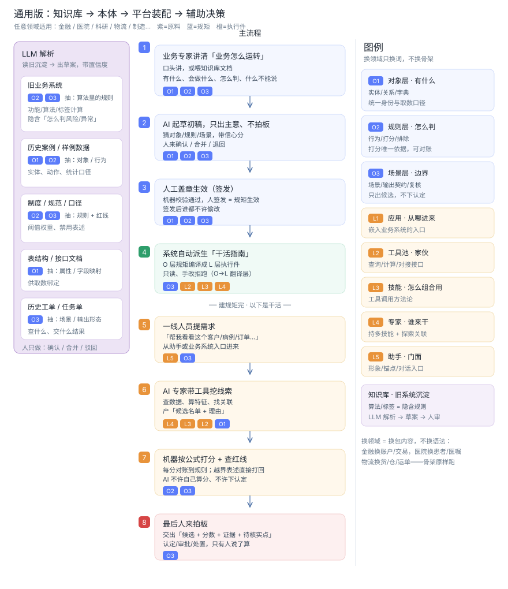

# dsh-onto — 业务本体建模平台

[English](README.md) | [中文](README.zh.md)

> 以 DeepSeek Harness（dsh）为宿主的**业务本体建模 + AI 辅助决策**平台：
> 把专家的业务口径写成机器可校验、可签发、可派生的结构；**判定在规则引擎，认定在人工**。
> 概念、规则与结构的完整定义见 [docs/architecture.md](docs/architecture.md)（自包含）。

## 总览

通用链路：**知识库 → 本体 → 平台装配 → 辅助决策**。任意领域只换包内容，不换骨架。



> 英文版见 [README.md](README.md) / [docs/overview-pipeline.en.svg](docs/overview-pipeline.en.svg)。

## 能力

| 能力 | 入口 |
|---|---|
| 包管理：创建 / 导入导出 / 版本 fork / 签发状态机（DRAFT→IN_REVIEW→ISSUED，ISSUED 只读） | `dsh-onto package *` / Web「包管理」 |
| 建模面：O1/O2/O3 结构录入 + YAML 导入 | Web「建模」 / `ontoModel.writeSource` |
| 知识库：六类原料上传 + LLM 解析（失败回落词面启发）+ 候选队列 + 人审 | `dsh-onto knowledge *` / Web「知识库」 |
| 校验器：引用闭合 / 权重=1.0 / 字典 / 事件口径 / 属性解析 + 质量分 | `dsh-onto validate` / Web「校验派生」 |
| 派生器：derived/** + manifest 指纹 + 加载门禁（DERIVED_DRIFT） | `dsh-onto derive` / `dsh-onto gate` |
| 规则引擎：排除（before-scoring）→ 打分（权重来自 O2），每分回指 ruleId | `core` 规则引擎 |
| 场景执行：pipeline 最小步派发 + 三层审计闭合 + 人审字段 | `dsh-onto run` / Web「场景运行」 |
| 第二域零改引擎：AML（反洗钱）+ MED（医疗）只换包内容 | `packages/` |

## 目录

```
dsh-onto/
  core/       @dsh-onto/core — 纯引擎库 + CLI（零 harness 依赖，node --test 103 项验收测试）
  backend/    @dsh-onto/backend — dsh bundle：onto* wire 服务（唯一后端落点）
  workbench/  @dsh-onto/workbench — dsh bundle：Web UI 五 tab
  packages/   业务本体包示例（一等交付物）：aml/1.0.0、med/1.0.0
  examples/   场景运行样例数据（aml-run.json / med-run.json）
  scripts/    setup-profile.ps1 / dev-web.ps1 / dump-config.ps1
  docs/       architecture.md（自包含架构与规则）
              overview-pipeline.{zh,en}.svg（端到端链路图）
```

## 快速开始

前置（一次性）：Node ≥ 22.19 + pnpm 11.x；
作为兄弟目录放置的 [deepseek-harness](https://github.com/deepseek-ai/deepseek-harness) 已完成
`pnpm install && pnpm run build`（harness **只读**依赖，本项目不改其一行代码）。

```powershell
# 1. 创建 dsh-onto profile 并安装 @dsh-onto/backend + @dsh-onto/workbench，播种示例包
dsh-onto\scripts\setup-profile.ps1
# 2. 核对组合配置（硬断言两个 @dsh-onto/* bundle 都在）
dsh-onto\scripts\dump-config.ps1
# 3. 启动 Web UI（浏览器访问打印的 dsh web URL）→ 侧栏「dsh-onto」
dsh-onto\scripts\dev-web.ps1
```

工作台五个 tab：**包管理 · 建模 · 知识库 · 校验派生 · 场景运行**。

## CLI（不经浏览器）

```powershell
cd dsh-onto\core
pnpm install; pnpm run build

node dist\cli.js package create --name demo --version 1.0.0 --domain DEMO --root ..\workspace
node dist\cli.js validate ..\packages\aml\1.0.0
node dist\cli.js derive   ..\packages\aml\1.0.0
node dist\cli.js gate     ..\packages\aml\1.0.0
node dist\cli.js run      ..\packages\aml\1.0.0 SCN-AML-FIND-CLUES --data ..\examples\aml-run.json --out result.json
node dist\cli.js knowledge upload --package demo --type LEGACY_SYS --name algo --file algo.txt --root ..\workspace
node dist\cli.js knowledge parse --source <id> --root ..\workspace
node dist\cli.js knowledge queue --root ..\workspace
```

## 产品纪律

1. 业务判定内容只活在 O2/O3；规则引擎是唯一判分路径，**禁止 LLM 参与打分**。
2. LLM 只起草草案（带置信度）；**原料永不直写包**，人审 approved 后才物化。
3. 结论性表述（认定/确定为/已构成…）只允许落 `forbiddenPhrases` 红线，**禁止进输出契约**。
4. **认定永远在人工**：输出恒为 `humanReviewRequired=true`；签发端点仅人工（issuedBy 为 human）。
5. 派生物只读可再生成；手改 → `DERIVED_DRIFT` 拒绝加载；重新派生恢复。
6. 输出必含：候选名单、风险分、命中规则 ID、证据链、待核实点；禁语零容忍扫描。

## 验收

`core/tests/`（103 项，`node --test tests/*.test.mjs`）覆盖验收清单：
校验拦截、六类原料解析、结论不进 O3、强制人审、ISSUED 只读、fork、
派生漂移拒绝与恢复、端到端场景字段齐全、ruleId/证据链/禁语零命中、第二域零改引擎。

## 边界（如实声明）

- 知识库 LLM 解析默认走词面启发（确定性）；DeepSeek API 需 `DEEPSEEK_API_KEY`（如 `~/.dsh/.env`）。
- 建模面为结构化录入 + YAML 导入，非自由画布（非目标）。
- 平台只做线索筛查与证据组装；认定与处置在人工（设计如此，不是待补功能）。

## 许可证

[MIT](LICENSE)
